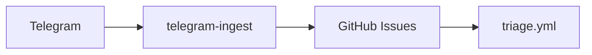

# Ingest: GitHub Issues + Triage Agent

Одна «вхідна скринька» для фідбеку по **sportapp** і автоматичне сортування через GitHub Actions (Claude Code Triage Agent).

## Що в репозиторії

| Шлях | Призначення |
|------|-------------|
| [.github/workflows/triage.yml](../.github/workflows/triage.yml) | Запуск на `issues.opened`, read-only triage |
| [.github/ISSUE_TEMPLATE/](../.github/ISSUE_TEMPLATE/) | Форми: баг (user/dev), ідея |
| [scripts/seed_github_issues.sh](../scripts/seed_github_issues.sh) | Мітки + 8 тестових issues |
| [telegram-ingest/](../telegram-ingest/) | Telegram → GitHub Issues (long polling, grammY) |

## Telegram ingest

Бот **не сортує** issues — лише створює їх з міткою `source:user`. Далі працює [Triage Agent](../.github/workflows/triage.yml).



### Передумови (етапи 0–2)

| Крок | Дія |
|------|-----|
| 0 | Мітка **`source:user`** існує (`bash scripts/seed_github_issues.sh` створює мітки) |
| 1 | @BotFather: `/newbot`, `/setcommands` → `bug`, `idea`, `help` |
| 2 | GitHub **fine-grained PAT**: repo `ryzhaknode/sportapp`, **Issues: Read and write** |
| 3 | **Triage:** секрет `ANTHROPIC_API_KEY` у Actions (нижче) |

Node **≥ 20.6** (`node --version`) — `.env` підвантажується через `--env-file`.

### Запуск бота

```bash
cd telegram-ingest
npm install
cp .env.example .env
# Заповни TELEGRAM_TOKEN, GITHUB_TOKEN, REPORTER_SALT (випадковий рядок)
# ALLOWED_USER_IDS поки порожній — бот відмовляє всім (закритий режим)
npm run dev
```

1. Надішли боту **`/myid`**, скопіюй ID у **`ALLOWED_USER_IDS`** у `.env` (через кому, якщо кілька людей).
2. Перезапусти бота.

**Production 24/7 (опційно):** VPS + `pm2 start npm --name tg-ingest -- start`, або Docker `node:22-alpine` з `restart: always`. GitHub webhooks для сповіщень у TG — окремий етап (потрібна публічна URL).

### Безпека

- Токени **тільки** в локальному `.env`, ніколи в git.
- Issues створюються **вашим** PAT → автор = owner → triage проходить `author_association`.
- Хто може писати боту — лише **`ALLOWED_USER_IDS`**.
- Текст neutralize ламає `@` (zero-width space), щоб не пінгати людей / `@claude`.
- Репортер у issue: псевдонім `tg-xxxxxxxx` (HMAC + `REPORTER_SALT`), без імені Telegram.

### Чекліст тестів (етап 6)

| # | Сценарій | Очікування |
|---|----------|------------|
| 1 | `/bug` + нормальний опис (≥15 символів) | Issue на GitHub, `source:user`, triage run у Actions |
| 2 | Той самий баг іншими словами | Triage: `possible-duplicate` |
| 3 | «не працює» (<15 символів) | Відмова в Telegram, **без** issue |
| 4 | 6 звернень за годину | 6-те: ліміт у Telegram |
| 5 | Текст з `@claude` | Issue без активного ping |
| 6 | Повідомлення з акаунта не з whitelist | Відмова |
| 7 | Невірний `GITHUB_TOKEN` | «Не вдалося зберегти», процес живий |
| 8 | Ctrl+C, знову `npm run dev` | Polling підхоплює повідомлення, надіслані офлайн |

Лічильники ліміту та `pending` — **in-memory** (скидаються при рестарті).

## Одноразове налаштування GitHub

1. **API ключ / Claude GitHub App**
   - У терміналі: `claude` → `/install-github-app`, **або**
   - Встановити [Claude GitHub App](https://github.com/apps/claude) на `ryzhaknode/sportapp`
   - Додати секрет **`ANTHROPIC_API_KEY`** у **Settings → Secrets and variables → Actions**

2. **GitHub CLI** (для seed): `gh auth login`

3. Публічний репо: triage спрацьовує лише для issues від **OWNER / MEMBER / COLLABORATOR** (захист від спаму та prompt injection).

## Перевірка після push

```bash
bash scripts/seed_github_issues.sh
```

Відкрий **Issues** і **Actions → Triage Agent**. Очікування:

- дублікати (вага 74.2, таймер) → `possible-duplicate` + коментар з посиланням;
- «щось зламалось» → `needs-info`;
- нормальні баги → `area:*`, `reproduced` або `needs-info`, **`needs-refinement`**;
- workflow **не** створює PR і не комітить код.

## Мітки

- **Джерело:** `source:user`, `source:dev` (майбутнє: `source:auto` для Sentry)
- **Тип (triage):** `type:bug`, `type:feature`, `type:question`
- **Triage:** `possible-duplicate`, `reproduced`, `needs-info`, `needs-refinement`
- **Область:** `area:workout`, `area:progression`, `area:db`, `area:ui`

`needs-refinement` — вхід для наступного етапу (Refinement Agent).

## Повідомити про баг (користувачам)

[Створити issue → шаблон «Баг»](https://github.com/ryzhaknode/sportapp/issues/new/choose)

## Наступні етапи (не в цьому PR)

- Sentry на Vercel → issues з `source:auto`
- Refinement Agent (workflow на `needs-refinement`)
