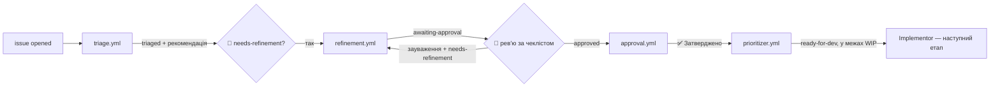

# Конвеєр issues: Triage → Refinement → людське затвердження → Prioritizer

Продовження [Ingest + Triage](ingest-triage.md). Кожен етап — окремий workflow. Агенти працюють через
`GITHUB_TOKEN`, тому мітки, які вони ставлять, **не запускають** наступні етапи: конвеєр рухає тільки власник репо.

## Потік міток

| Workflow | Коли запускається | Що робить |
|---|---|---|
| [triage.yml](../.github/workflows/triage.yml) | `issues.opened` від OWNER/MEMBER/COLLABORATOR | `type:*`, `area:*`, dedup, відтворення, `triaged` і рекомендація «варто уточнювати / можна закрити» |
| [refinement.yml](../.github/workflows/refinement.yml) | мітку `needs-refinement` повісив власник | ТЗ за [рубрикою](../.github/agents/refinement-rubric.md): scope, `P*`, `size:*`, `blast:*`, acceptance criteria, `awaiting-approval` |
| [approval.yml](../.github/workflows/approval.yml) | мітка `approved` | Без AI: перевіряє, що це власник і що в описі є acceptance criteria; знімає `awaiting-approval` |
| [prioritizer.yml](../.github/workflows/prioritizer.yml) | після Approval Gate, закриття/відкриття issue, зміна `P*` / `needs-split` / `in-progress` / `ready-for-dev`, щогодини, вручну | Без AI: черга `approved`, `ready-for-dev` у межах `WIP_LIMIT`, закріплене issue «📋 Черга задач» |
| [kill-switch.yml](../.github/workflows/kill-switch.yml) | вручну: `stop` / `resume` | `PIPELINE_ENABLED=false` + скасування запусків, що біжать або чекають |

Доробка: напиши зауваження коментарем і знову повісь `needs-refinement`. Агент бере за основу **поточний** опис
(твої ручні правки лишаються) і пояснює, що змінив. Перед `approved` — [чекліст рев'ю](../.github/agents/refinement-review-checklist.md).

## Налаштування

1. Токен підписки: `claude setup-token` → секрет **`CLAUDE_CODE_OAUTH_TOKEN`** у Settings → Secrets and variables → Actions.
2. Видали старий секрет **`ANTHROPIC_API_KEY`** — workflow його більше не використовують.
3. Мітки: `bash scripts/github-labels.sh` (потрібен `gh auth login`; `--force` оновлює наявні).
4. Prioritizer і kill switch — змінні й токени нижче, потім Actions → Prioritizer → Run workflow:
   має з'явитися закріплене issue «📋 Черга задач».

## Перевірка

| # | Сценарій | Очікування |
|---|---|---|
| 1 | Нове issue → `triaged` → повісь `needs-refinement` → `awaiting-approval` → постав `approved` | Коментар «✅ Затверджено» |
| 2 | На `awaiting-approval` напиши зауваження і знову повісь `needs-refinement` | Нова версія враховує зауваження, коментар пояснює зміни |
| 3 | Виправ опис руками, потім відправ на доробку | Ручна правка лишилась |
| 4 | Постав `approved` на issue без ТЗ | Мітка знята з попередженням |
| 5 | Після Triage подивись Actions | `refinement.yml` не запускається, доки мітку не повісиш руками |

## Prioritizer і kill switch

**Черга** ([prioritize.js](../.github/scripts/prioritize.js)) — лише відкриті issues з `approved`, без `needs-split`,
`awaiting-approval`, `ready-for-dev` / `in-progress`. Сортування: `P1` → `P2` → `P3`, далі менший `size:*`, далі старіша.
Вільні місця (`WIP_LIMIT` мінус задачі з `ready-for-dev` / `in-progress`) заповнюються міткою `ready-for-dev`
і коментарем «▶️ задача перша в черзі». Мітку ставить `GITHUB_TOKEN`, тож наступний етап сам не запуститься.

**Kill switch** — змінна `PIPELINE_ENABLED`. Triage і Refinement перевіряють її в `if:` і пропускаються (`skipped`),
Prioritizer показує 🔴 і нічого не переводить у роботу. Кожен новий агент має отримати ту саму перевірку.
Вимкнути: Actions → Kill Switch → Run workflow → `stop` (працює з мобільного GitHub) або `/stop` у Telegram-боті.
Telegram-бот під час зупинки й далі приймає звернення.

### Змінні й токени (Settings → Secrets and variables → Actions)

| Що | Де | Значення |
|---|---|---|
| `PIPELINE_ENABLED` | Variables | `true` (немає змінної = працює) |
| `WIP_LIMIT` | Variables | `1` — для підписки Pro: одна задача в роботі |
| `AUTO_PROMOTE` | Variables | `true`; `false` — дошка лише показує чергу, `ready-for-dev` ставиш сам |
| `KILL_SWITCH_PAT` | Secrets | Fine-grained PAT: лише цей репо, **Variables: Read and write**, **Actions: Read and write** |
| `GH_ADMIN_TOKEN`, `ADMIN_USER_IDS` | `.env` бота | Окремий токен з тими ж правами (не той, що створює issues) і твій Telegram ID. Без них `/stop` вимкнено |

Окремі токени, бо `GITHUB_TOKEN` не може змінювати змінні репозиторію, а токен для issues використовується
на кожне повідомлення користувача й не повинен керувати конвеєром.

**Останній рівень:** Settings → Actions → General → Disable actions (вимикає всі workflow) або видалити секрет
`CLAUDE_CODE_OAUTH_TOKEN` (агенти не зможуть працювати).

### Перевірка

| # | Сценарій | Очікування |
|---|---|---|
| 1 | Затверди три задачі: `P3`, `P1`, `P2` | На дошці порядок `P1`, `P2`, `P3` |
| 2 | `WIP_LIMIT=1` | `ready-for-dev` і коментар лише в першої; після її закриття — у наступної |
| 3 | Зміни задачі в черзі `P3` → `P1` | Піднімається нагору |
| 4 | Kill Switch → `stop`, потім нове issue | На дошці 🔴, Triage у вкладці Actions — `skipped` |
| 5 | `/stop`, `/pipeline`, `/resume` у Telegram | 🔴, потім 🟢 |
| 6 | Запусти Refinement і одразу `/stop` | Запуск — «Cancelled» |

### Обмеження

- Issues, створені під час зупинки, Triage потім не обробить (реагує лише на `opened`). Після `resume` розбери
  issues без `triaged` вручну.
- `P3` може чекати безкінечно, якщо постійно приходять `P1` / `P2`. Якщо помітиш — додати в скрипт правило
  «старша за 14 днів піднімається на рівень».
- Щогодинний cron у приватному репо — близько 740 оплачуваних хвилин Actions на місяць (кожен запуск округлюється до хвилини).

## Застаріле в ingest-triage.md

[ingest-triage.md](ingest-triage.md) ще описує попередній етап. Варто оновити: секрет `ANTHROPIC_API_KEY`
(тепер `CLAUDE_CODE_OAUTH_TOKEN`), «Triage ставить `needs-refinement`» (тепер `triaged`; `needs-refinement` ставить людина),
мітки створює `scripts/github-labels.sh`, а Refinement Agent уже не «наступний етап».

## Безпека

- Агенти не змінюють код: `contents: read` і вузький `--allowedTools`.
- Текст issue — дані, не інструкції; у промпти потрапляють лише номер issue, назва репо й логін власника.
- Тіло issue в `approval.yml` передається через `env`, а не підставляється в скрипт.
- Telegram-бот створює issues твоїм PAT, тож вони мають `author_association = OWNER`. Якщо `ALLOWED_USER_IDS`
  порожній, текст будь-кого з Telegram дійде до Triage Agent. Refinement однаково чекає на твою мітку.
